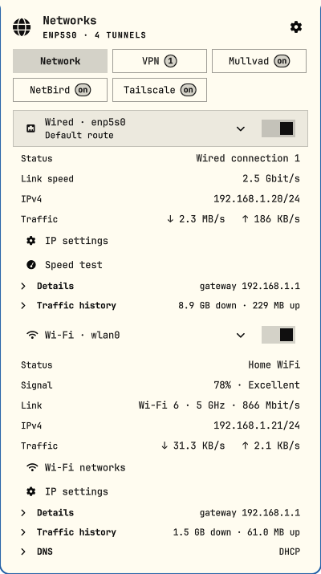
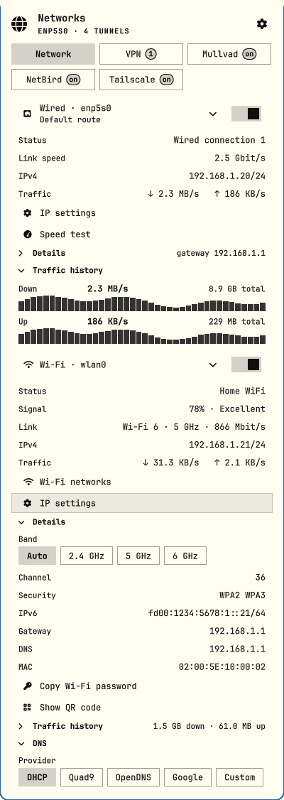
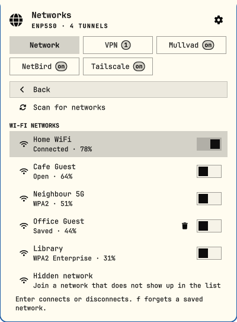
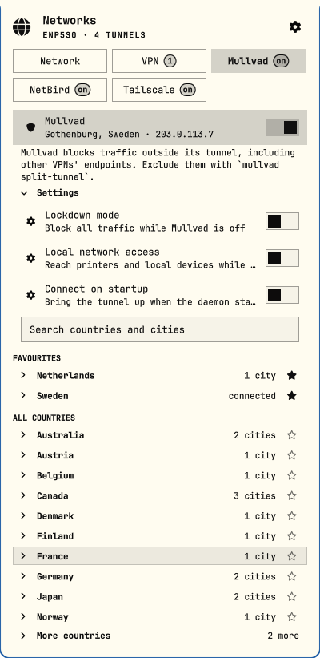
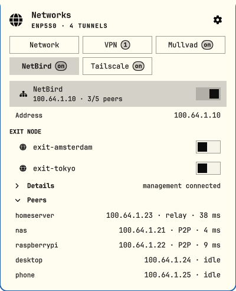
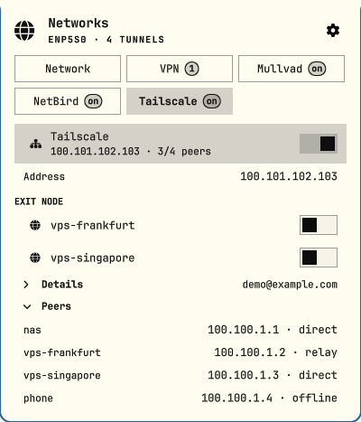
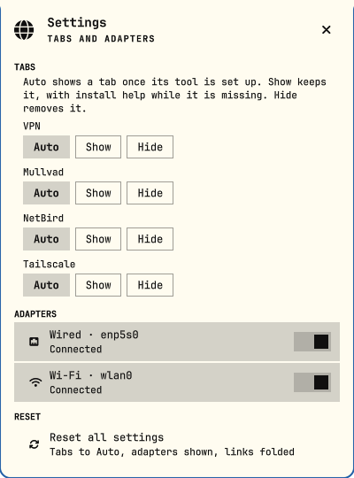

# Networks for Omarchy

Wi-Fi, wired, DNS and every VPN, in one panel in the [Omarchy](https://omarchy.org) bar. Several VPNs can be connected at the same time, so split-tunnel setups just work.

<p align="center">
  
</p>

> All screenshots here use made-up data (see [Development](#development)).

## What it does

- **Network**: your wired and Wi-Fi links at a glance (address, link speed, Wi-Fi generation, live traffic), each with its own on/off switch. Fold a link down to one line; the choice is remembered.
- **Wi-Fi**: pick a network, connect (open, WPA, WPA-Enterprise with a pinned server name and CA, hidden), forget saved ones, rescan, show a QR code to share the network, copy its password, and pin the band.
- **IP settings**: DHCP or a static address, with the netmask, gateway and DNS validated before anything is applied.
- **DNS**: DHCP, Quad9, OpenDNS, Google or your own servers.
- **Speed test**: latency, packet loss, download and upload on the link that carries your traffic.
- **VPN**: NetworkManager WireGuard, OpenVPN and friends. Each tunnel has its own switch and nothing disconnects another, so tunnels that only carry certain addresses can run side by side. It only warns when two tunnels both claim all your traffic.
- **Mullvad**: every country and city with search and favourites, plus lockdown mode, local network access and connect-on-startup.
- **NetBird** and **Tailscale**: connect, pick an exit node, browse peers and copy their addresses.
- **The bar icon** shows how you are connected: wired, or Wi-Fi with its generation (4, 5, 6, 6E, 7), and a dot while a VPN is up.

<table>
  <tr>
    <td></td>
    <td></td>
    <td></td>
  </tr>
  <tr>
    <td></td>
    <td></td>
    <td></td>
  </tr>
</table>

Tabs for tools you do not have stay out of the way. Turn one on in settings (the cog) and it shows how to install the tool instead.

## Install

```bash
omarchy plugin add https://github.com/vleeuwenmenno/omarchy-networks.git --enable
```

Then put it on the bar, wherever you like:

```bash
omarchy bar put io.github.vleeuwenmenno.networks --after omarchy.clock
```

Update with `omarchy plugin update`, then `omarchy restart shell` to load the new code.

## Remove

```bash
omarchy plugin remove io.github.vleeuwenmenno.networks
rm -f ~/.local/state/omarchy/menno-networks.json   # optional: forget favourites and settings
```

## Using it

Click the icon to open the panel. Middle-click refreshes. Click the cog (or press `s`) for settings.

| Key | Does |
|-----|------|
| `j` / `k`, arrows | move the cursor |
| `Enter` | act on the row: fold a link, connect, copy a value, open a dropdown |
| `h` / `l` | previous / next tab |
| `1` to `9` | jump to a tab |
| `t` | turn the link under the cursor on or off |
| `c` | fold or unfold the link under the cursor |
| `f` | forget the saved Wi-Fi network under the cursor |
| `r` | refresh |
| `s` | settings |
| `Esc` | back one level, then close |

A link or tunnel only changes state when you click its switch (or press `t`), never because you clicked a row.

## Requirements

Omarchy with its Quickshell shell, and:

- **NetworkManager** (`nmcli`), `iproute2` (`ip`), `iw`, `ping`, `wl-clipboard` (`wl-copy`)
- Omarchy's own helpers: `omarchy-network-qr`, `omarchy-network-password`, `omarchy-network-band`, `omarchy-network-speedtest` and `omarchy-dns`
- Optional, per tab: [`mullvad`](https://mullvad.net), [`netbird`](https://netbird.io), [`tailscale`](https://tailscale.com), and `wg-quick` for WireGuard interfaces NetworkManager does not manage

## Permissions

The plugin runs unsandboxed inside the shell, like every Omarchy plugin. Most of what it does needs no privileges. These actions ask for your password through `pkexec`, and only when you click them:

- changing DNS (`omarchy-dns`)
- turning off a WireGuard interface that NetworkManager does not manage (`wg-quick down`)
- letting your user control Tailscale (`tailscale set --operator`)

Wi-Fi passphrases and static DNS servers are handed to `nmcli` and Omarchy's helpers on stdin or through a pipe, never as command-line arguments. Every interface name, address and location code that reaches a command is validated first. Enterprise Wi-Fi (PEAP) profiles are only created with a server name that must match the RADIUS certificate, and a CA file or the system CA bundle, so a lookalike network cannot collect your password. Before the panel activates or reconnects a saved profile (joining a saved network, applying IP settings, switching band) it reads that profile's 802.1X settings. A password-based profile that does not pin a CA and a server name (made by an older version or another tool) is not activated: its automatic connection is turned off, and the panel asks for the server name and replaces it. If the profile cannot be read, nothing connects. nmcli's editor runs with a private, temporary history directory, so passwords never reach `~/.cache/nmcli-history`. A copied Wi-Fi password is marked sensitive (kept out of clipboard history) and served for one paste, at most for a minute. The install help in the empty tabs shows install and `sudo systemctl` commands. You can copy them, or click a button to run one in a terminal window; nothing runs without that click.

## Development

```bash
make test       # model tests, no shell needed
make lint       # qmllint
make validate   # Omarchy's plugin schema
```

The logic lives in `model/*.js` (pure, tested); `*.qml` only draws it and runs commands. Sections are one file each under `sections/`.

The screenshots come from a demo mode that swaps the real machine for the made-up one in `model/Demo.js`. Turn it on with a flag file, restart the shell, and drive it over IPC:

```bash
echo '{"demo": true}' > ~/.local/state/omarchy/menno-networks-demo.json
omarchy restart shell
omarchy-shell io.github.vleeuwenmenno.networks open
omarchy-shell io.github.vleeuwenmenno.networks.dev view mullvad mv.settings -
omarchy-shell io.github.vleeuwenmenno.networks.dev snapshot /tmp/mullvad.png
rm ~/.local/state/omarchy/menno-networks-demo.json   # back to the real machine
```

In demo mode nothing runs and nothing is saved.

## License

[MIT](LICENSE)
